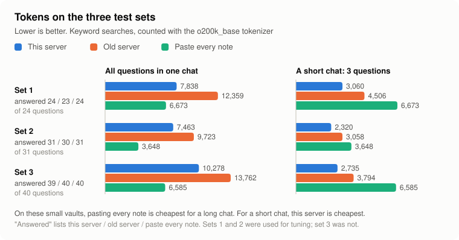

# RAG results: tokens and answers

Every number here comes from a saved result file in `bench/results/`, produced by the scripts in `bench/`.
Nothing is estimated. Percentages are rounded to one decimal. Where something got worse, it says so.

## The short version

There are two ways to give an AI your project memory: paste every note into the chat, or let it search. The
benchmark compares three setups on three fake vaults:

- **Paste every note.** Every note's text, once, at the start of the chat. Every answer is in front of the AI,
  so this is the quality reference.
- **Old server.** The original project: line-by-line text search.
- **This server.** Search with SQLite FTS5, short results and a short start-of-chat summary.

<picture>
  <source media="(prefers-color-scheme: dark)" srcset="docs/charts/test-sets-dark.svg">
  
</picture>

| Keyword searches | Set 1 | Set 2 | Set 3 |
|---|---:|---:|---:|
| **A short chat** (start summary and 3 searches) | | | |
| Paste every note | 6,673 | 3,648 | 6,585 |
| Old server | 4,506 | 3,058 | 3,794 |
| This server | **3,060** | **2,320** | **2,735** |
| **Every question in one chat** | | | |
| Paste every note | **6,673** | **3,648** | **6,585** |
| Old server | 12,359 | 9,723 | 13,762 |
| This server | 7,838 | 7,463 | 10,278 |
| **Answers found** | | | |
| Paste every note | 24 of 24 | 31 of 31 | 40 of 40 |
| Old server | 23 of 24 | 30 of 31 | 40 of 40 |
| This server | 24 of 24 | 31 of 31 | 39 of 40 |

In plain words:

- **Against pasting every note, a short chat costs 36.4% to 58.5% fewer tokens** (set 1: −54.1%, set 2: −36.4%,
  set 3: −58.5%), and this server found 94 of the 95 answers. That is the goal of "about half the tokens with
  almost the same answers", for short chats.
- **For a long chat on a small vault, pasting every note is cheaper.** If one chat asks every question, this
  server uses 17.5% (set 1), 104.6% (set 2) and 56.1% (set 3) more tokens than pasting every note once. These
  vaults have only 24 to 34 notes.
- **As the vault grows, pasting stops being possible.** At 491 notes, pasting every note costs 90,086 tokens per
  chat; a short chat with this server costs 3,345. At 4,730 notes: 834,815 against 3,004 (see "Speed and
  growth").
- **Against the old server:** every question in one chat costs 36.6%, 23.2% and 25.3% less; a short chat costs
  32.1%, 24.1% and 27.9% less.

**Which set to trust.** Set 1 was used to tune the search from the start. Set 2 was written after round 1, kept
out of round 2, and used for tuning in round 3. Set 3 was written before round 3, never used for tuning, and run
once before and once after round 3. **Set 3 is the honest number.**

## What was measured, in plain words

- **Three fake vaults**, all invented:
  - Set 1 (`bench/fixture-vault/`): an online ordering app for a bakery, 32 notes.
  - Set 2 (`bench/holdout-vault/`): a volunteer app for a community garden, 24 notes, using Obsidian features
    set 1 lacks: front matter, tags, `[[links]]`, tables, code blocks, callouts, file names with spaces.
  - Set 3 (`bench/test3-vault/`): a hiking app, 34 notes. Long notes, tables, an unrelated side project as a
    distractor, and 5 facts that changed over time (an older note says something different; the right answer
    is the current one).
- **The questions.** Each has a short answer that must appear in what the server returns: 25 in set 1, 33 in
  set 2 and 42 in set 3. Set 2 has 9 and set 3 has 10 questions worded differently from the notes. Sets 2 and 3
  each have 2 questions with no answer in the notes, which only measure cost. Plus 4 writes per set.
- **The scripted agent** (`bench/run.ts`). It connects through a real MCP client and acts like an AI: read the
  start-of-chat summary, then for each question search once; if the answer is not in the result, read one listed
  note. It is an ideal agent: when the right note is listed, it always picks it. Every server gets the same
  agent.
- **Two ways of asking.** "Keyword": a short search term (`Twilio`). "Question": the full question. The old
  server only finds exact text, so keywords are the fair comparison with it.
- **Two chat sizes.** "Every question in one chat": tool descriptions, server instructions, the start-of-chat
  summary and every search and read result. "A short chat": tool descriptions, instructions, the start summary
  and 3 searches of average cost. Pasting every note costs the same either way.
- **Counting.** Tokens are counted offline with the `o200k_base` tokenizer (OpenAI's, via `js-tiktoken`).
  Claude and Gemini split text a little differently, so the percentages matter more than the exact numbers.
- **Repeatable.** A fresh copy of the vault for every run, the clock frozen, no network. Same code, same
  numbers.

```bash
npm run bench
```

```bash
npm run bench -- --set holdout
```

```bash
npm run bench -- --set test3
```

## The full numbers (round 3, keyword searches)

| What the AI reads | Set 1 old | Set 1 new | Set 2 old | Set 2 new | Set 3 old | Set 3 new |
|---|---:|---:|---:|---:|---:|---:|
| Tool descriptions + instructions | 886 | 558 | 886 | 558 | 886 | 558 |
| Start-of-chat summary | 2,549 | 1,850 | 1,506 | 1,248 | 2,141 | 1,597 |
| All searches and reads | 8,924 | 5,430 | 7,331 | 5,657 | 10,735 | 8,123 |
| **Every question in one chat** | **12,359** | **7,838** | **9,723** | **7,463** | **13,762** | **10,278** |
| Change | | −36.6% | | −23.2% | | −25.3% |
| Whole session, with 4 writes and the AI's own arguments | 13,286 | 8,649 | 10,392 | 8,037 | 14,531 | 10,965 |

Sources: `bench/results/dev-after-r3.json`, `holdout-after-r3.json` and `test3-after.json`, rows `baseline` and
`current`, style `keyword`.

### Answer quality

| | Set 1 old | Set 1 new | Set 2 old | Set 2 new | Set 3 old | Set 3 new |
|---|---:|---:|---:|---:|---:|---:|
| Answers found (keywords) | 23/24 | 24/24 | 30/31 | 31/31 | 40/40 | 39/40 |
| Found by the search alone, without reading a note | 19/24 | 21/24 | 27/31 | 30/31 | 39/40 | 39/40 |
| Mean reciprocal rank | 0.505 | 0.764 | 0.618 | 0.742 | 0.796 | 0.807 |
| Answers already in the start summary | 10 | 9 | 8 | 8 | 15 | 13 |
| Full questions: answers found | 0/24 | 23/24 | 0/31 | 29/31 | 0/40 | 36/40 |
| Full questions: every question in one chat | 3,981 | 7,635 | 3,122 | 9,206 | 3,950 | 13,308 |

*Mean reciprocal rank* scores where the answer appears: 1 if in the first result, 0.5 if second, 0.33 if third,
0 if missing, averaged. Higher is better. The old server finds nothing for full questions (0 answers); its low
token count there is the cost of answering nothing.

On set 3:

- **Questions worded differently from the notes:** 10 of 10 found with keywords, 6 of 10 with full questions.
- **Facts that changed over time:** 5 of 5 found. "Found" means the current value was in the results; older
  values can be there too, and the AI has to prefer the newer note.
- **Questions with no answer:** 248 and 4 tokens spent with keywords.

## What got worse, or is still missing

1. **Pasting every note beats this server for a long chat on a small vault** (see the short version).
2. **Set 3 lost one answer the old server found.** "What does one emergency share cost us in text messages?",
   searched as `Twilio`. The word appears in 7 notes. In the note with the answer it sits in a long list item
   under a heading without the word, so that passage scored 2.19 against the best result's 4.96: below the
   rule that a result must score at least half as well as the best one. It was not shown even with a limit of
   10. The old server lists every matching line, so it showed it. A more specific search, `Twilio cost`, puts
   that note first.
3. **Full questions worded differently from the notes are still missed.** On set 3, 4 of 10: "Which tool do we
   use to measure app usage?" (the note says PostHog), "How often do we change our backend keys?" (the note
   says "rotate"), "Is there a cheaper price for people at university?" (the note says "Students do not get a
   discount") and "How stable was the app after the late-September update?" (the note says "crash-free").
   Keyword search only finds words that are in the note. A real embedding model might find these; it was not
   measured (see "Optional vectors").
4. **The start summary holds fewer answers.** It shows the newest decisions in full, older ones as one line, and
   only open tasks: set 1 holds 9 answers (old: 10), set 3 holds 13 (old: 15).
5. **Answers rank lower on set 2 than in round 1.** Mean reciprocal rank on set 2 was 0.851 in round 1 and is
   0.742 now. Every answer is still found, but more often in second or third place.
6. **The first search is slower than the old server's.** It builds the index: 3.0 seconds at 4,730 notes (see
   "Speed and growth").

## How it got here: four rounds

Whole scripted session with keyword searches, 4 writes and the AI's own arguments, in tokens:

| Round | What changed | Set 1 | Set 2 | Set 3 |
|---|---|---:|---:|---:|
| Old server | Line-by-line text match, up to 50 lines | 13,286 | 10,392 | 14,531 |
| RAG version 1 | 5 whole sections per search | searches 2.8% **worse** than old | not measured | not written yet |
| Round 1 | Only matching lines shown; one-word coincidences dropped | 9,663 | 11,093 (**+6.7%**) | not written yet |
| Round 2 | Rank passages, score cutoff, partial matches, one line per older decision | 9,329 | 9,252 | 12,530 |
| Round 3 | Matching sentences only, near-duplicates dropped, shorter labels | **8,649** | **8,037** | **10,965** |

Set 2 was measured before round 2 changed anything (`bench/results/holdout-before.json`): it showed round 1 was
**worse** than the old server on notes it had not been tuned on. Set 3 was measured before round 3
(`bench/results/test3-before.json`) and after it (`test3-after.json`), and not in between.

### Round 3, in plain words

- **Matching sentences only.** Each result is split into sentences, list items and table rows. Each scores the
  number of different search words in it. The best result shows its matching sentences plus the one or two after
  them, because the answer often comes right after the sentence that matches ("We discussed X. Agreed: Y."), up
  to 450 characters. Other results show up to 180. Lines such as "Model: Claude" are skipped.
- **Near-duplicates dropped.** A result that shares 60% or more of its meaningful words with one already shown is
  dropped (Jaccard similarity).
- **Shorter labels.** Session headings lose their timestamp, a section named like its note is not repeated, and
  the data notice went from 12 tokens to 7.
- **One line per decision** in the start summary, with its date.

**Tried in round 3 and rejected**, because each lost at least one answer on set 2: ranking by the share of search
words matched, one result per note, a stricter score cutoff (0.6), and smaller start-summary budgets. Their exact
token numbers were not saved.

**A new gate:** `tests/quality.test.ts` fails if a change loses an answer on sets 1 or 2, or adds more than 5% to
their search tokens.

### Round 2 settings sweep (set 1 only)

| Score cutoff | Best hit chars | Other hits chars | Searches, keyword | Answered | Searches, question | Answered |
|---:|---:|---:|---:|---:|---:|---:|
| 0 | 400 | 200 | 6,489 | 24/24 | 7,289 | 23/24 |
| 0 | 600 | 200 | 6,420 | 24/24 | 7,314 | 23/24 |
| 0.35 | 600 | 200 | 6,313 | 24/24 | 6,675 | 23/24 |
| 0.5 | 400 | 200 | 6,159 | 24/24 | 5,743 | 23/24 |
| **0.5** | **600** | **200** | **6,090** | **24/24** | **5,768** | **23/24** |
| 0.65 | 600 | 200 | 5,505 | 24/24 | 5,554 | **22/24** |

The bold row was chosen in round 2: the cheapest setting that lost no answer. Full list:
`bench/results/sweep-round2.txt` (round 1: `sweep-round1.txt`). Round 3 then cut the character limits to 450 and
180 by choosing sentences instead of cutting text.

## The cost of the security work

The labels from the first security round cost 81 tokens per session on set 1. The OWASP round (see
[SECURITY_REPORT.md](SECURITY_REPORT.md)) changed the set 1 session from 9,328 to 9,329 tokens and changed no
answer.

## Optional vectors

**Built-in `ngram` vectors** (`RAG_EMBEDDINGS=ngram`, measured). They compare three-letter pieces of words,
which helps with typos, not with meaning. With keyword searches they made almost no difference (−45 to +39
tokens); with full questions they cost 16.9% to 20.2% more:

| Every question in one chat | Set 1 | Set 2 | Set 3 |
|---|---:|---:|---:|
| Keywords only | 7,838 | 7,463 | 10,278 |
| Keywords + ngram, keyword searches | 7,846 | 7,502 | 10,233 |
| Keywords only, full questions | 7,635 | 9,206 | 13,308 |
| Keywords + ngram, full questions | 9,176 | 10,764 | 15,588 |

They found the same answers in every case. Off by default.

**A real embedding model through Ollama** (`RAG_EMBEDDINGS=ollama`): **not measured.** The build environment
could not download a model. Its safety rules were tested (SECURITY_REPORT.md: AB-5 to AB-7, SL-3, O6-4, O9-3,
O9-4). To measure it on your own computer:

```bash
ollama pull nomic-embed-text
```

```bash
npx tsx bench/run.ts --set test3 baseline current current-ollama
```

## Speed and growth (synthetic vaults)

`bench/scale.ts` builds bigger vaults by copying set 1 into `Archive/copy-N/` folders and growing the decision
and task logs. They are **synthetic**: good for speed and size, not for answer quality. Run on **one core**
(`taskset -c 0`) of an Intel Xeon at 2.10 GHz, not on an actual laptop, so a slow laptop will be slower. Source:
`bench/results/scale.json`.

| Notes | Paste every note | Short chat, old server | Short chat, this server | First search (builds the index) | Later searches |
|---:|---:|---:|---:|---:|---:|
| 32 | 6,674 tokens | 4,705 | 3,286 | 26.8 ms | 3.3 to 7.7 ms |
| 491 | 90,086 | 11,192 | 3,345 | 441.5 ms | 22.8 to 42.8 ms |
| 1,895 | 336,785 | 17,221 | 2,984 | 1,260.9 ms | 75.6 to 101.3 ms |
| 4,730 | 834,815 | 29,391 | 3,004 | 3,047.1 ms | 169.3 to 228.2 ms |

- The short chat here uses three fixed searches (`delivery`, `PayLoop webhook secret rotation` and a full
  question), so its numbers differ a little from the test-set tables.
- This server's start summary stays at 1,850 tokens at every size; the old one grew from 2,549 to 26,128.
- This server's search results stayed between 122 and 357 tokens at every size. The old server returned 1,228 to
  2,751 tokens for `delivery`, and nothing for the two longer searches.
- The index lives in memory and nothing is written to disk. Process memory grew by about 29 MB at 4,730 notes (a
  rough reading). Every search first checks each note's size and change time and re-reads only changed notes,
  so search time grows with the number of notes.
- The heavy tests also build a 10,000-note vault and check it stays within generous limits (index under 2
  minutes, a search under 5 seconds, under 1.5 GB of memory growth).

## Real books and outside questions

A separate benchmark uses real text and questions written by other people: [docs/book-benchmark.md](docs/book-benchmark.md).
In short:

- **10,570 SQuAD questions** about 48 Wikipedia articles (330,795 tokens): the answer reached the AI for 82.3%,
  at 186 tokens per search. Pasting as much as fits in 200,000 tokens covers 54.7%; the right article alone, if
  you knew which, is 6,885 tokens.
- **20 made-up facts hidden in Moby Dick** (291,728 tokens): 20 of 20 found with words from the fact; 8 of 10
  with reworded questions that keep a name; 0 of 10 with questions sharing no word with the fact.
- **One word is not enough:** the question's rarest single word found 43.6% of SQuAD answers.
- **It found two bugs**, both fixed: a note over 1 MB was left out of search without any message, and dialogue
  such as "You are now going to leave me" was flagged as an order to an AI in 5 of 587 book chapters.

## Limits of this benchmark

- Three small fake vaults and one tokenizer. A real vault will behave differently; the book benchmark above uses
  real text.
- The scripted agent is ideal and simple. Real AIs sometimes search twice, read the wrong note, or skip searching.
  Every setup got the same agent.
- "Answered" means the answer text was in what the AI received, not that an AI then answered correctly.
- Sets 1 and 2 were used for tuning. Set 3 is the honest check, and it was run on this version once.
