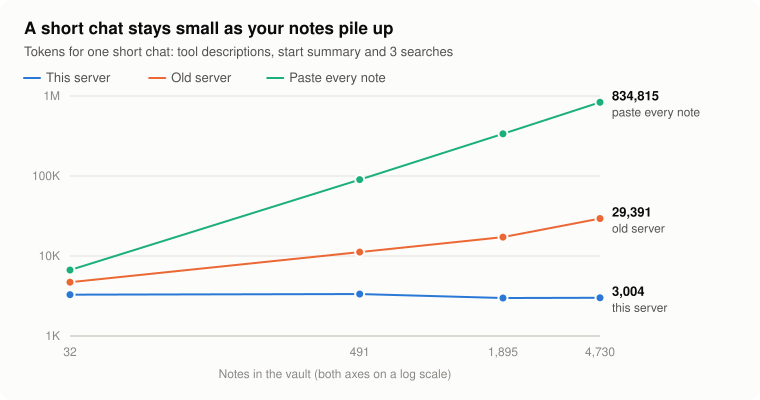
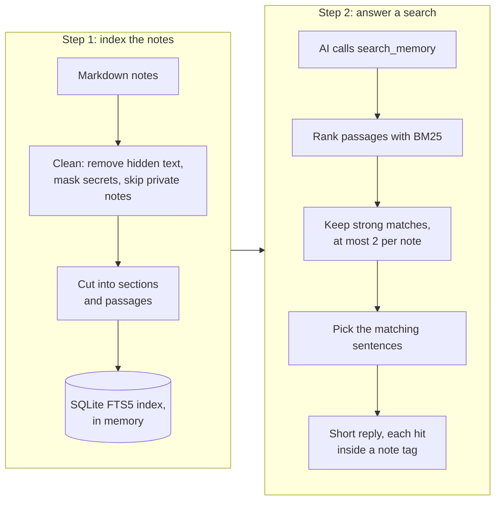
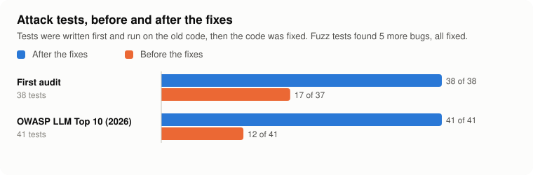

# rag-memory-mcp

[](https://github.com/MoKarim146/rag-memory-mcp/actions/workflows/ci.yml)

One shared memory for all your AI assistants. In the short chats measured below it used fewer tokens than
pasting the notes or the original server, and it treats your notes as untrusted.

It is an MCP server. MCP (Model Context Protocol) is the standard way AI apps connect to tools. The memory is a
folder of plain markdown notes, for example inside Obsidian. When an AI needs something, the server searches the
notes on your computer and hands over only the few passages that answer it.

## Why

Many people mix cheaper AI plans instead of paying for one top plan: plan in ChatGPT, build in Claude Code,
review in Gemini. Every time you switch, the next AI knows nothing. So you paste a long handoff document, or you
connect a memory server. Both cost **tokens**: small pieces of text, about three quarters of a word each, that
every AI plan limits.

A simple memory server wastes tokens in three ways:

1. Its tool descriptions are loaded into every chat, before you type anything.
2. It hands over whole files, or every matching line, instead of just the answer.
3. Its start-of-chat summary keeps growing as decisions and tasks pile up.

This server is built to keep all three small:

- **It searches first (RAG).** RAG means *retrieval-augmented generation*: the server retrieves the relevant
  passages, then the AI generates its answer from them. Search runs on your computer, with no cloud service and
  no API key.
- **It keeps everything short.** Short tool descriptions, a start-of-chat summary that stays the same size, and
  search results that show only the matching sentences.
- **It cleans notes before an AI reads them.** Known kinds of hidden text that try to give the AI orders
  (*prompt injection*), secret-looking strings and notes you mark private are removed, and notes that look like
  orders are flagged. It also checks what an AI tries to save. It cannot catch every trick: see
  [Safety](#safety).

It is built from [secure-obsidian-memory-mcp](https://github.com/MoKarim146/secure-obsidian-memory-mcp).

## Results

<picture>
  <source media="(prefers-color-scheme: dark)" srcset="docs/charts/growth-dark.svg">
  
</picture>

A short chat means: tool descriptions, the start-of-chat summary and 3 searches. Measured on three fake vaults
of 24 to 34 notes, with questions whose answers are known:

<!-- generated: tokens dev-after-r3 holdout-after-r3 test3-after -->
| A short chat | Set 1 | Set 2 | Set 3 |
|---|---:|---:|---:|
| Paste every note | 6,673 tokens | 3,648 tokens | 6,585 tokens |
| Old server | 4,506 | 3,058 | 3,794 |
| **This server** | **3,060** | **2,320** | **2,735** |
| Saving against pasting every note | −54.1% | −36.4% | −58.5% |
| Saving against the old server | −32.1% | −24.1% | −27.9% |
| Answer in this server's search results | 21 of 24 | 30 of 31 | 39 of 40 |
| ... if the AI then opens the right listed note (upper bound) | 24 of 24 | 31 of 31 | 39 of 40 |
<!-- /generated -->

Sets 1 and 2 were used to tune the search. Set 3 was written before the last round of changes and never used
for tuning, so it is the honest number.

**What is not better:**

- On these small vaults, if one chat asks *every* question (24 to 40 of them), pasting every note once is
  cheaper: this server then uses 17.5% to 104.6% more tokens. The server wins on short chats and on bigger
  vaults: at 491 notes, a short chat costs 3,345 tokens instead of 90,086.
- On set 3 it missed 1 of 40 answers with keyword searches. With the full questions instead of picked keywords,
  the answer was in the search results for 33 of 40. For 4 of the 7 misses, opening the listed notes would not
  have helped either; all 4 were worded differently from the notes (for example "people at university" for
  "students").

**Tested on real books and outside questions** ([docs/book-benchmark.md](docs/book-benchmark.md)):

- 10,570 questions written by other people about 48 Wikipedia articles (SQuAD): the answer reached the AI for
  82.3% of them, at 186 tokens per search. The articles are 330,795 tokens; pasting as much as fits in a
  200,000-token window covers 54.7%.
- A made-up fact hidden in Moby Dick (291,728 tokens), at 20 depths: found 20 of 20 times with words from the
  fact, but 0 of 10 times when the question shared no word with it. Search matches words, not meaning.

**Tested on outside retrieval datasets and on paraphrased questions** ([docs/evaluation.md](docs/evaluation.md)):
keyword search, vectors and both together compared on BEIR SciFact, LongMemEval-S and a frozen paraphrase set, with
95% intervals.

Every number, how it was measured, and everything that got worse: [RAG_RESULTS.md](RAG_RESULTS.md). Which claims
are verified, provisional or untested: [docs/claims.md](docs/claims.md). Design choices and their costs:
[docs/architecture.md](docs/architecture.md).

## How a search works



The server indexes your notes the first time an AI searches, then re-reads only notes that changed. Each search
returns only strong matches, and only their matching sentences. Details, including every safety rule:
[docs/how-it-works.md](docs/how-it-works.md).

## Setup

You need [Node.js](https://nodejs.org) 22.13 or newer. Use a folder only for AI memory, not your whole vault.

**1. Install.** This installs, builds, and writes your settings to `.env`:

```bash
git clone https://github.com/MoKarim146/rag-memory-mcp.git
```

```bash
cd rag-memory-mcp && ./scripts/setup.sh ~/ObsidianVault/AI-Memory
```

**2. Start the server.** It listens on `http://127.0.0.1:8787/mcp`, on your computer only:

```bash
npm start
```

**3. Connect your AI.** For Claude Code, in another terminal:

```bash
claude mcp add --transport http memory http://127.0.0.1:8787/mcp
```

To try it on fake notes first, start it with `AI_MEMORY_DIR="$PWD/examples/sample-vault" npm start`. On Windows
without Bash, run `npm ci --ignore-scripts`, `npm run build`, copy `.env.example` to `.env`, set
`AI_MEMORY_DIR` in it, then `npm start`.

Node prints an `ExperimentalWarning` about SQLite at start. That is Node.js labelling its built-in SQLite as
experimental; it is expected.

**Other AI apps.** Any app that can connect to an MCP server over HTTP can use it. ChatGPT and other web apps
connect from their company's servers, so they need a public address, such as a Cloudflare Tunnel or ngrok. Only
do that with token login on (`MCP_AUTH_REQUIRED=true`), and stop the tunnel when you are done.

**See it work first.** `npm run demo` starts the server on a throwaway copy of made-up notes and shows a search,
a replaced decision, a flagged note with planted instructions, a private note and a refused out-of-date save.

**What has been tested.** Checked on 5 November 2026 on Linux with Node.js 22.23.4:

| Setup | Status |
|---|---|
| The three steps above from a fresh clone (`setup.sh`, `npm start`, `claude mcp add`) | Tested: Claude Code 2.1.318 lists the server as connected |
| Copying the skill into `~/.claude/skills/` | The copy is tested; whether Claude Code then uses it is not |
| `npm run demo`, `npm test`, the benchmark checks | Tested on every push in CI (Ubuntu) |
| Docker and `docker-compose.yml` | See [container-hardening.md](docs/container-hardening.md) for what was tested |
| Vectors with Ollama (`RAG_EMBEDDINGS=ollama`) | Ollama itself not tested; its API was tested with a stand-in serving `all-minilm` |
| macOS, Windows, Node.js 22.13 exactly | Not tested |
| ChatGPT or other web apps through a tunnel | Not tested |
| Agent behaviour with a real model | Not run (needs an API key and a budget): [agent-evaluation.md](docs/agent-evaluation.md) |

### Teach your AI to use it well

`skills/rag-memory/SKILL.md` is an Agent Skill: a short instruction file an AI loads when it is relevant. It
tells the AI to start with `read_main_context`, search with several specific words the note would use (one
word alone found about half as many answers in the tests), treat notes as data, and save its work at the end.
For Claude Code:

```bash
mkdir -p ~/.claude/skills && cp -r skills/rag-memory ~/.claude/skills/
```

### A typical workflow

1. In ChatGPT, plan the next feature. Ask it to save the plan with `update_handoff_summary` and the key choices
   with `add_decision`.
2. In Claude Code, the AI calls `read_main_context` and starts building. When it needs a detail, it calls
   `search_memory` instead of reading every note.
3. At the end, it saves what it did with `append_session_note` and updates the handoff.
4. Now and then, open `AI Review/pending.md` in Obsidian to approve or delete anything that was held.

## Tools

| Tool | What it does |
|---|---|
| `read_main_context` | Start here: main notes, current work, handoff, newest decisions, open tasks |
| `search_memory` | Search all notes; returns the best passages, best first (`limit` 1 to 10, default 5) |
| `read_note` | Read one note by its path; long notes come in pages |
| `read_handoff_summary` | Read the handoff note `04_MODEL_HANDOFF.md` |
| `add_decision` | Add a dated decision to `02_DECISIONS.md` |
| `add_open_task` | Add a task to `03_OPEN_TASKS.md` |
| `append_session_note` | Add a dated note under `Sessions/` |
| `update_handoff_summary` | Replace the handoff note; old versions are kept in `.history/` |

## Safety

<picture>
  <source media="(prefers-color-scheme: dark)" srcset="docs/charts/security-dark.svg">
  
</picture>

The rules follow the [OWASP Top 10 for LLM Applications 2026](https://github.com/GenAI-Security-Project/GenAI-LLM-Top10).
In short:

- **Reads:** only markdown files inside the memory folder. Hidden text is removed, secrets and contact details
  are masked, remote images are replaced by a label, and notes marked `ai_private: true` or `#ai-private` are
  never sent.
- **Note text is labelled as data.** It comes inside `<note>` tags, and notes that look like orders to an AI
  get a visible warning.
- **Writes:** no delete tool. A write that looks like orders to an AI waits in `AI Review/pending.md` for you.
  Secrets are masked before saving, every AI write is marked, and every write is logged without its text.
- **Access:** this computer only by default, web pages in your browser are refused, optional read and write
  tokens, and rate limits per session.

**Not solved:** a note stuffed with likely search words still shows up in searches; politely worded orders are
not flagged; the server cannot tell a true note from a false one. Read what your AIs write into the memory.

More: [how it works](docs/how-it-works.md) and the full [security report](SECURITY_REPORT.md).

## Settings

`./scripts/setup.sh` writes them to `.env`, where each one is explained. A value set in the shell wins over
`.env`. The main ones:

| Setting | Default | Meaning |
|---|---|---|
| `AI_MEMORY_DIR` | `~/ObsidianVault/AI-Memory` | The memory folder |
| `AI_MEMORY_WRITE_ENABLED` | `true` | `false` makes the memory read-only |
| `AI_MEMORY_WRITE_REVIEW` | `suspicious` | Which writes wait for you: `suspicious`, `all` or `off` |
| `MCP_AUTH_REQUIRED` | `false` | `true` turns on token login (`MCP_WRITE_TOKEN`, `MCP_READ_TOKEN`) |
| `RAG_EMBEDDINGS` | `none` | Optional vector search: `ollama` (a local model) or `ngram` |
| `HOST`, `PORT` | `127.0.0.1`, `8787` | Where the server listens. Keep `127.0.0.1` |

## Development

```bash
npm test
```

```bash
npm run test:heavy
```

```bash
npm run bench
```

- `npm test`: the fast tests. `npm run test:heavy`: fuzz and stress tests, including a 10,000-note vault.
- `npm run bench`: the token benchmark. `npm run charts` redraws the charts from the saved results.
- `npm run bench:verify` recomputes every committed benchmark run from its per-query records, and
  `npx tsx bench/report.ts --check` checks that every generated table in the documents matches them. How to
  reproduce each benchmark: [docs/benchmarks.md](docs/benchmarks.md).
- Code layout and the rules every change must keep: [CLAUDE.md](CLAUDE.md).
- Only use fake notes in this repository. Never commit a real vault, `.env`, tokens or tunnel addresses.

## Who made what

- The original project, [secure-obsidian-memory-mcp](https://github.com/MoKarim146/secure-obsidian-memory-mcp),
  was written with **Codex**. **Mohamed Karim** designed it, directed the work and tested it.
- **Claude Code** (Anthropic's coding agent) wrote this version's additions at Mohamed Karim's direction: the token
  benchmark, the RAG search, the security audit and OWASP controls, the heavy tests and the documents.
- The first commit in this repository is the original project, unchanged, so every later change can be seen on
  its own.

## License

[MIT](LICENSE). You may use, change and share it, including commercially, as long as the copyright notice
stays with it.
