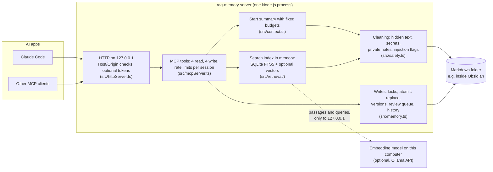

# Architecture and tradeoffs

A short map of the parts, how one search and one write travel through them, and the choices behind them with what
each choice costs. The details of every rule are in [how-it-works.md](how-it-works.md); the measurements are in
[evaluation.md](evaluation.md), [book-benchmark.md](book-benchmark.md) and [RAG_RESULTS.md](../RAG_RESULTS.md).

## The parts

- **The notes are the database.** Everything lives in plain markdown files that you can read and edit in
  Obsidian. The server keeps nothing else except `.history/` (old handoffs, the audit log, lock files) and
  `AI Review/pending.md` (writes waiting for you).
- **The index is derived and kept in memory only.** It is built on the first search and refreshed before each
  search from the files' sizes and change times. It is never written to disk.
- **The old server is kept** in `bench/baseline/` as the historical baseline every benchmark compares against.

## One search

1. The AI calls `search_memory` with words or a question.
2. The index re-reads notes that changed, after cleaning them (hidden text removed, secrets and contact details
   masked, private notes left out).
3. Passages are ranked by BM25 on keywords; with an embedding model, also by vector similarity, and the two lists
   are merged by reciprocal rank fusion.
4. Weak matches are dropped (relative cut-off, at most 2 results per note), and each result is cut to the
   sentences that match (450 characters for the best, 180 for the others).
5. The reply wraps each result in a `<note>` tag marked as data, with a warning on notes that look like orders.

## One write

1. The AI calls a write tool (`add_decision`, `add_open_task`, `append_session_note` or
   `update_handoff_summary`).
2. The text is checked: hidden text and remote content are refused, secrets masked, and text that looks like
   orders to an AI is held in `AI Review/pending.md` instead of being saved.
3. The write runs under a lock for that note (in the process and across processes), is marked as written by an
   AI, and is appended, or for the handoff replaced atomically with the old version kept. A handoff save with an
   out-of-date `expected_version` is refused.

## Choices and what they cost

| Choice | Instead of | Why | What it costs |
|---|---|---|---|
| Markdown files as the only store | a database or vector store | you can read, edit and back up your memory with ordinary tools; no migration | no transactions across notes; writes rely on lock files, which are not reliable on network or synced folders |
| Index in memory, rebuilt after each start | an index saved on disk | nothing derived from your notes is written anywhere else; a hand edit can never leave a stale copy | each start pays for indexing again, and vectors are recomputed after every restart (about 54 passages per second on one CPU core with `all-minilm`) |
| Keyword search (BM25) by default, vectors optional | always-on embeddings | nothing to install, no model, exact names and codes match well | questions worded unlike the notes are mostly missed without vectors: see the paraphrase tables in [evaluation.md](evaluation.md) |
| Vectors only from a model on this computer | a cloud embedding API | notes never leave the computer | you install and run the model; without it there is no meaning search |
| Reciprocal rank fusion of keyword and vector lists | blending raw scores | needs no calibration between two kinds of score | on the paraphrase set it put the target in the top 5 more often than vectors alone, but ranked it lower on average (the paired differences in [evaluation.md](evaluation.md); the ranking drop may be chance) |
| Small results: matching sentences, fixed character budgets, at most 2 per note | whole sections or notes | fewer tokens per search | the answer can fall just outside the snippet; the AI then has to call `read_note` |
| Relative score cut-off | always returning k results | fewer weak results to read | a right but weakly matching note can be dropped |
| Start summary with fixed budgets per note | the whole main notes | its size stays about the same as the project grows | older decisions are shown by their first sentence only |
| A decision is replaced only by an explicit `Supersedes` line | "newest wins" | a newer note written by another AI cannot silently override what the user decided | real conflicts are left for the user to settle, which means more questions to the user |
| Note text labelled as data, hidden text removed, obvious orders flagged | trusting notes | defence in depth against prompt injection through notes | politely worded orders are not flagged, and a note stuffed with likely search words still ranks: see [SECURITY_REPORT.md](../SECURITY_REPORT.md) |
| No delete tool; appends, and a replaced handoff kept in history | full edit tools | an AI that is tricked cannot wipe the memory | the AI cannot clean up old notes; you do that by hand |
| Version check on handoff saves is optional (`expected_version`) | always required | older clients keep working | a client that does not pass it can still overwrite a newer handoff (the old one is kept in history) |
| Listens on 127.0.0.1, no login by default | open network access | nothing outside this computer can reach it | any program on this computer can use the tools; web apps such as ChatGPT need a tunnel and token login |

## Not in scope

- Several people sharing one server: there are no user accounts or per-note permissions beyond `ai_private`.
- Telling true notes from false ones: the server shows where a fact came from, not whether it is right.
- Notes other than markdown (PDFs, images, code files).
