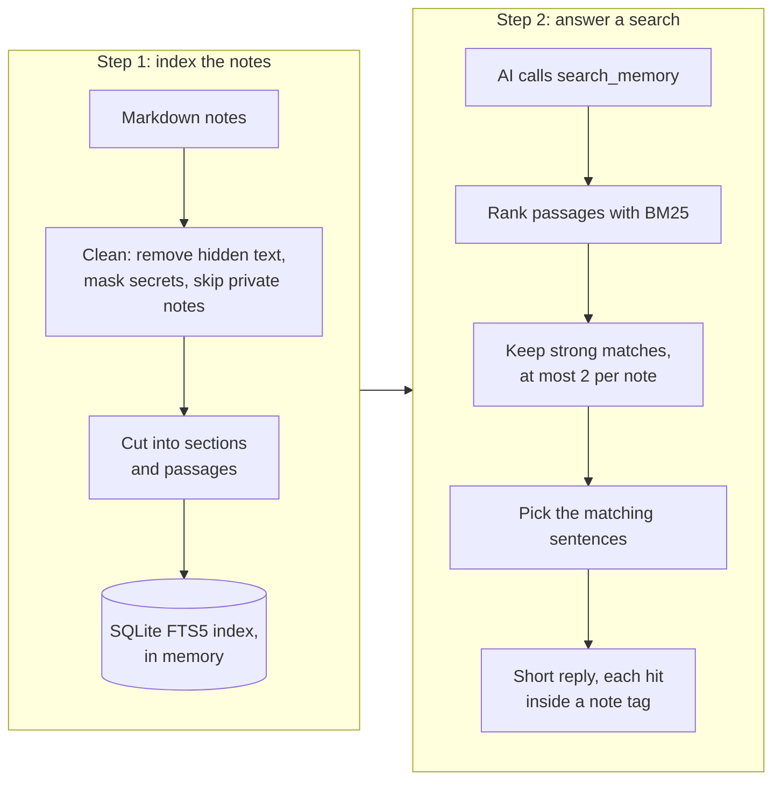

# How it works

This page explains, in plain words, how the server saves tokens and how it keeps notes safe. The code is in
`src/`; every rule below has a test in `tests/`.

## The memory folder

The memory is a folder of markdown notes, for example a folder inside your Obsidian vault. Five main notes are
created if they are missing:

| Note | What goes in it |
|---|---|
| `00_MAIN_CONTEXT.md` | What the project is, its goals and rules |
| `01_CURRENT_WORK.md` | What is being worked on now |
| `02_DECISIONS.md` | Dated decisions with their reasons (`add_decision` appends here) |
| `03_OPEN_TASKS.md` | Open tasks (`add_open_task` appends here) |
| `04_MODEL_HANDOFF.md` | A short note from the last AI to the next one (`update_handoff_summary` replaces it) |

Session notes go in `Sessions/`. Any other markdown note in the folder can be searched and read.

## How a search works

1. **Clean.** Every note is cleaned before it is indexed or shown (see "Safety" below). A private note is not
   indexed at all.
2. **Cut into pieces.** A note is cut into *sections* (the text under one heading) and each section into
   *passages*: one list item, one paragraph, one table row (with the table's header row kept as context) or one
   code block.
3. **Index.** The passages go into a full-text index. It uses SQLite FTS5, the full-text search built into the
   SQLite that ships with Node.js, so there is nothing extra to install. Words are stemmed, so "rolling back"
   also finds "roll back", and accents are ignored. The index lives in memory and is never written to disk.
   Before each search the server checks each note's size and change time and re-reads only the notes that
   changed.
4. **Rank.** Passages are scored with BM25, the standard formula search engines use: rare words count more than
   common ones, and a word in the note's name or headings counts double. A section's score is its best passage's score. This is
   called *small-to-big* retrieval: the small passage that answers the question wins, then it is shown under
   its section's heading.
5. **Keep only strong matches.** A section must score at least half as well as the best one. A question of 3
   or more words must match at least 2 of them. At most 2 sections per note and 5 per search (the AI can ask
   for up to 10). If nothing matches well, up to 2 partial matches come back, labelled `match="partial"`.
   Notes that look like orders to an AI only appear when nothing clean matches.
6. **Show only the matching sentences.** Each hit is split into sentences, list items and table rows. The best
   hit shows its matching sentences plus the one or two after them (the answer often comes right after the
   sentence that matches), up to 450 characters. Other hits show up to 180 characters. "…" marks a gap. A hit
   that repeats one already shown (60% or more of the same words) is dropped.
7. **Reply.** Each hit comes back inside a `<note>` tag with its path and section, and the reply starts with a
   one-line reminder that note text is data, not instructions.

`read_note` still returns a whole note (in pages for long notes) when the AI needs more than a snippet.

### Optional: embeddings

An *embedding* turns text into a list of numbers so that texts with similar meaning end up close together. It
can find "undo a release" when the note says "roll back". It is off by default (`RAG_EMBEDDINGS=none`).

- `RAG_EMBEDDINGS=ollama` uses a real embedding model through [Ollama](https://ollama.com) on your own
  computer. Only a local address is accepted (`localhost`, `127.0.0.1` or `::1`), redirects are refused and
  replies are capped at 8 MB.
- `RAG_EMBEDDINGS=ngram` is a small built-in option that compares three-letter pieces of words. It helps with
  typos, not meaning, and it did not improve the benchmark.

Each passage gets its own vector, made from the passage and its section heading, so a one-sentence fact is not
averaged into the text around it. A section's vector score is its best passage's score, and that passage is
shown in the result even when it shares no word with the question. Keyword results and embedding results are
merged with *reciprocal rank fusion*: each result gets points for how high it ranks in each list, and the totals
decide the order. Vector matches below `RAG_MIN_SIMILARITY` (default 0.45 for Ollama) are ignored.
`RAG_RETRIEVAL=keyword` or `dense` uses only one of the two lists (for comparisons; `hybrid` is the default).

Some models expect a short task label before the text: `nomic-embed-text`, the default model, wants
`search_query: ` before a search and `search_document: ` before a passage. The server adds the labels that the model
cards of `nomic-embed-text`, `mxbai-embed-large`, `snowflake-arctic-embed` and `bge-large` ask for; `all-minilm` and
`bge-m3` need none. For another model, set `RAG_EMBED_QUERY_PREFIX` and `RAG_EMBED_DOCUMENT_PREFIX`. Only `all-minilm`
was evaluated ([evaluation.md](evaluation.md)). If the model cannot be reached or fails, search goes on with keywords
only, and the benchmark records report it as `vectorStatus: "failed"`.

Costs, measured with `all-minilm` on one CPU core: about 54 passages embedded per second; 48 Wikipedia articles
are 5,999 passages (9 MB of vectors), 18 long books are 62,174 passages (95 MB, about 19 minutes to embed).
Vectors are kept in memory only, so they are recomputed after every restart, and until they are complete each
search spends up to 10 seconds embedding more passages.

## Writes: one at a time, never half-written

- **One at a time.** Writes to the same note run one after another inside the server, and a lock file in
  `.history/locks/` keeps two server processes on the same vault from writing the same note at once. A lock left
  by a crashed process is removed after 30 seconds. Exclusive file creation, which the lock relies on, is
  reliable on local disks; on network or synced folders (SMB, Dropbox, iCloud) it may not be.
- **Never half-written.** The handoff is written to a temporary file and renamed over the old one, so Obsidian or
  another process sees the old text or the new text, never part of it.
- **Every old handoff is kept.** The version being replaced is added to `.history/04_MODEL_HANDOFF.md` inside the
  same locked step, including edits you made by hand. Before this fix, 12 overlapping replacements lost 11 of the
  12 new versions completely: only the original and the last write survived (`security/stage1-before-fixes.json`).
- **Conflicts are refused, if the AI asks.** `read_handoff_summary` shows a `version`. When
  `update_handoff_summary` gets `expected_version` and the handoff has changed since (another AI, another session
  or a hand edit), the write is refused and the AI is told to read it again. Without `expected_version` the write
  still goes through, and the old text is kept in history.

## Index lifecycle and limits

- One index per vault and indexing policy (embedding settings, email and phone masking, `RAG_MAX_NOTES`). Sessions
  with the same policy share it; a session with a different policy gets its own, so text indexed without masking
  is never served to a session that masks. Indexes live in memory for as long as the server runs.
- Before each search, every note's size and change time are checked and changed notes are read again. A note
  edited so fast that both stay the same is not noticed until its next change; this is rare on modern disks.
- A note that is deleted or marked private leaves the index and its vectors on the next search.
- Limits: notes over 1 MB are not searched (they are named, see above), at most 20,000 notes (`RAG_MAX_NOTES`)
  and 200 MB of text are indexed.

## Decisions: who wrote them, and what replaces what

- Every decision an AI adds ends with `(added by AI via MCP)`, and the start summary marks it `(AI)` where it
  shortens it.
- A decision replaces an earlier one only when it says so: `add_decision` takes `supersedes`, the id of the earlier
  decision (its date, or `date#2` for the second one that day, as the start summary shows it), and writes a
  `Supersedes:` line. The id must exist, or nothing is saved.
- The start summary lists a replaced decision among the older ones, marked `(superseded by <id>)`, so it is not
  shown as current. A newer decision that disagrees without `Supersedes` replaces nothing: both stay current, and
  the skill tells the AI to show the user both instead of picking the newest.

## How the start-of-chat summary stays short

`read_main_context` returns the five main notes with fixed limits:

- each main note up to 4,000 characters;
- the newest decisions in full (up to 1,500 characters), older ones as one line each with only their first
  sentence (up to 900 characters);
- open tasks only, up to 2,000 characters; finished tasks are left out.

So the summary stays about the same size however long the project runs. On the test vault it was 1,850 tokens;
the old server's summary grew to 26,128 tokens at 4,730 notes.

## Safety

The server treats every note as untrusted: a note can be pasted from the web, written by another AI, or
planted by someone else. The rules follow the
[OWASP Top 10 for LLM Applications 2026](https://github.com/GenAI-Security-Project/GenAI-LLM-Top10); each rule's
tests are listed in [SECURITY_REPORT.md](../SECURITY_REPORT.md).

### What the AI reads

- **Only the memory folder.** Only markdown files inside it. `../` tricks, absolute paths, symlinks that point
  outside and hidden folders such as Obsidian's `.trash` are refused. The `AI Review/` folder is never read.
- **No hidden text.** Text you cannot see but an AI can is removed: `<!-- -->` and `%% %%` comments,
  `[//]: # ()` comment links, HTML hidden with `hidden`, `display:none`, zero font size or white text,
  zero-width and other invisible characters, and terminal control codes.
- **No secrets.** API keys, tokens, passwords and private keys are replaced with `[secret removed]` (22 rules).
  Email addresses, phone numbers and card numbers are masked too (`MASK_EMAILS`, `MASK_PHONE_NUMBERS`).
- **No leaking images.** Remote images and embedded pages are replaced by a label, so a note cannot make an AI
  repeat an image link that sends data to someone's server when it is displayed.
- **Private notes stay private.** A note with `ai_private: true` in its front matter, or the tag `#ai-private`,
  is never read, searched or sent.
- **Orders in notes are labelled.** All note text comes inside `<note>` tags with the reminder that it is data.
  A note that looks like orders to an AI ("ignore previous instructions", including look-alike letters and
  base64) gets a visible warning.

### What an AI can write

- **No delete tool.** Writes only append to fixed notes or replace the handoff, whose old versions are kept in
  `.history/`.
- **Suspicious writes wait for you.** A write that looks like orders to an AI is not saved. It goes to
  `AI Review/pending.md`, which you see in Obsidian and no AI can read. With `AI_MEMORY_WRITE_REVIEW=all`, every
  write waits.
- **Hidden text and remote content are refused.** Comments, invisible characters, remote images, scripts and
  `javascript:` links in a write are refused. Secrets are masked before saving.
- **AI writing is marked.** Everything an AI writes ends with `(added by AI via MCP)`, and search labels
  session notes `written_by="ai"`.
- **Limits.** Field sizes, 2 MB per file, 20 writes per 10 minutes per session, a third identical write within
  5 minutes is refused, 120 calls per minute per session, 32 open sessions, idle sessions closed after 30
  minutes.
- **Audit log.** Every write is recorded in `.history/audit.jsonl`: time, session, tool, file, outcome, size and
  a hash of the text, never the text itself.

### Who can connect

- The server listens on `127.0.0.1` (this computer only) by default.
- Requests from web pages in your browser are refused (Host and Origin checks), so a website cannot reach the
  server through your browser.
- Optional token login (`MCP_AUTH_REQUIRED=true`): a write token can use every tool, a read token only the read
  tools. Tokens are compared in constant time and must be 32 or more characters.
- `AI_MEMORY_TOOLS` offers only the tools you list; `AI_MEMORY_WRITE_ENABLED=false` makes the memory read-only.

### Not solved

- A note stuffed with likely search words but no obvious order still shows up in searches.
- Politely worded orders are not flagged.
- The server cannot tell a true note from a false one.

Keep the memory folder for memory only, and read what your AIs write into it.
